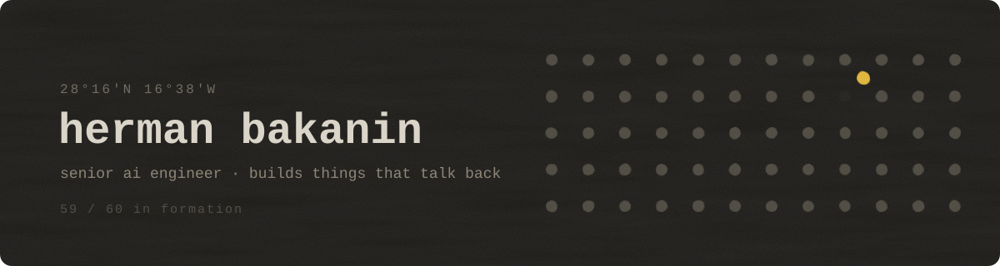

<p align="center">
  
</p>

<p align="center">
  <a href="https://cv.evquee.com">
    
  </a>
</p>

<p align="center">
  <a href="https://cv.evquee.com"></a>
  <a href="https://www.linkedin.com/in/herman-bakanin/"></a>
  
  
</p>

## 🫵 whoami

- 🧑‍💻 **senior AI engineer** w/ 7+ years of shipping. I build AI features *and* the whole product around them, idea → prod, no hand-offs
- 🌋 coding from **Tenerife**. yes, on an island. no, I'm not humble about it
- 📞 built [**CallRelay**](https://github.com/highsierraloft/callrelay): a self-hosted AI agent that makes *actual* phone calls through an Android SIM. it's giving *Her*, but open source
- 🤖 Claude Code, Codex & Cursor run through my whole SDLC. I write the spec, they cook, I review every line. zero vibe-coded slop
- 📦 10+ client apps shipped, enterprise tooling for **Roche**, a student app for hundreds of US students rebuilt in ~3 weeks. we stay locked in 🔒
- 👀 50+ repos, like 6 public. kinda sus ngl ඞ
- 💼 open to **fully remote** gigs → [slide into my LinkedIn](https://www.linkedin.com/in/herman-bakanin/)

```ts
const herman = {
  role: "Senior AI Engineer",
  basedIn: "Tenerife, Spain 🌋",
  mains: ["TypeScript", "Python"],
  sideQuests: ["Flutter", "Kotlin", "Java"],
  currentlyCooking: ["AI agents", "MCP servers", "voice AI", "Telegram bots"],
  packageManager: "bun", // non-negotiable
  touchedGrass: false, // it's basalt here tbh
  sus: true, // ඞ
};
```

## 🛠️ the roster

<p align="center">
  
  <br />
  
</p>

<p align="center">
  
  
  
  
</p>

## 🏆 featured W's

<p align="center">
  <a href="https://github.com/highsierraloft/callrelay"></a>
  <a href="https://github.com/highsierraloft/url-shortener"></a>
</p>

## 📊 the receipts

<p align="center">
  
</p>

<p align="center">
  
</p>

<p align="center">
  <picture>
    <source media="(prefers-color-scheme: dark)" srcset="https://raw.githubusercontent.com/highsierraloft/highsierraloft/output/snake-dark.svg" />
    <source media="(prefers-color-scheme: light)" srcset="https://raw.githubusercontent.com/highsierraloft/highsierraloft/output/snake-light.svg" />
    
  </picture>
</p>

<p align="center"><i>thanks for pulling up 🫡 now go star something</i></p>

<p align="center">
  
</p>
