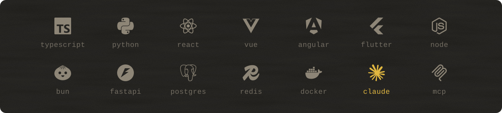

  

 

  most of what I build lives in private repos. 
  one of them <a href="https://github.com/highsierraloft/callrelay">makes phone calls on its own</a>.

 

  

 

  <a href="https://cv.evquee.com">cv.evquee.com</a>&nbsp;&nbsp;·&nbsp;&nbsp;<a href="https://www.linkedin.com/in/herman-bakanin/">linkedin</a>

 

  

